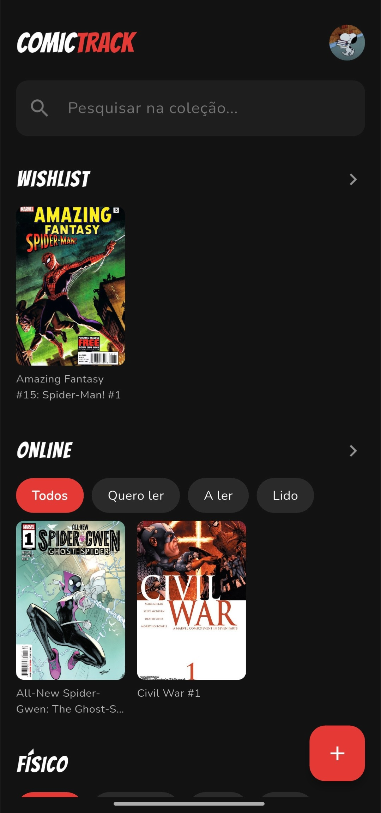
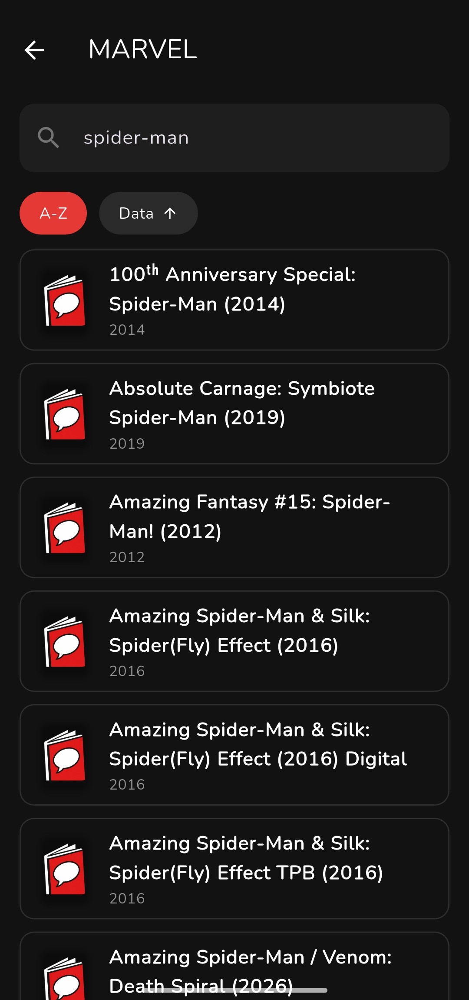
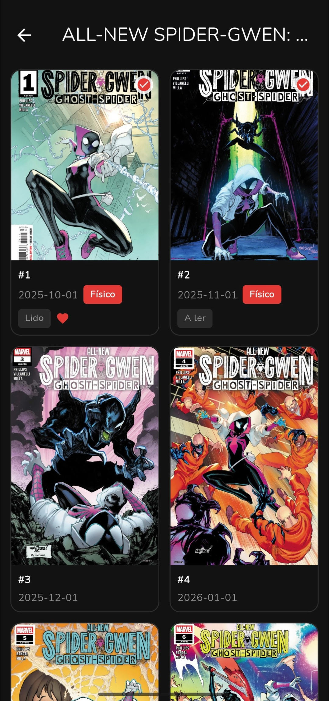
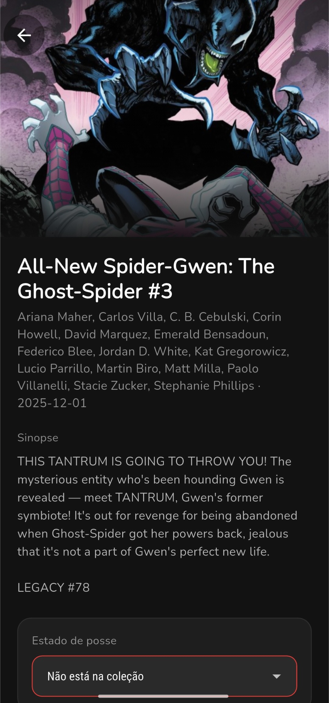

<h1 align="center">
  
</h1>

<p align="center">
  A Flutter app to manage your personal comic book collection. Browse publishers, series and issues, and keep track of what you own and what you've read.
</p>

<p align="center">
  
  
  
</p>

> Final project for the *Mobile Applications Project* course unit of the Software Development CTeSP at ISTEC Porto (academic year 2025/2026). Developed as a group project.

## Screenshots

<table align="center">
  <tr>
    <td align="center"></td>
    <td align="center"></td>
    <td align="center"></td>
    <td align="center"></td>
  </tr>
  <tr>
    <td align="center"><sub>Home</sub></td>
    <td align="center"><sub>Catalog</sub></td>
    <td align="center"><sub>Issue list</sub></td>
    <td align="center"><sub>Issue detail</sub></td>
  </tr>
</table>

## Features

- **Authentication**: email/password or Google Sign-In, email verification, password recovery and profile editing (name and photo).
- **Catalog**: search series, browse publishers, series by publisher, and issues by series, with a detail view for each issue, powered by the [Metron](https://metron.cloud/) API.
- **Personal collection**: for each issue, set the ownership status (not collected, wishlist, online, physical) and the reading status (want to read, reading, read), mark it as a favorite, or remove it from your collection.
- **Offline support**: collection data is synced with Cloud Firestore and cached locally, and the publisher list is cached for offline browsing.

## Tech stack

| Area | Technology |
| --- | --- |
| Framework | Flutter / Dart (SDK `>=3.10.0 <4.0.0`) |
| State management | [flutter_riverpod](https://pub.dev/packages/flutter_riverpod) + `riverpod_generator` |
| Navigation | [go_router](https://pub.dev/packages/go_router) |
| Backend | Firebase (Authentication + Cloud Firestore) |
| External API | [Metron Comic Book Database](https://metron.cloud/) via `dio` (Basic Auth, rate-limiting interceptor) |
| Data models | `freezed` + `json_serializable` |
| Error handling | `fpdart` (`Either` / `Option`) |
| Testing | `flutter_test` + `mocktail` |

## Architecture

The project follows Clean Architecture, organized by feature. Each feature is split into three layers: `data`, `domain` and `presentation`.

```
lib/
├── app/             # global router and theme
├── core/            # configuration (.env), errors, Metron HTTP client, utilities
└── features/
    ├── auth/        # authentication and user profile
    ├── catalog/     # publishers, series and issues (Metron API data)
    └── collection/  # user's personal collection (Firestore)
        ├── data/          # datasources, models, repositories
        ├── domain/        # entities, repositories, use cases
        └── presentation/  # providers, screens, widgets
```

## Getting started

### Prerequisites

- [Flutter SDK](https://docs.flutter.dev/get-started/install) `>=3.10.0`
- A [Firebase](https://firebase.google.com/) project with Authentication and Cloud Firestore enabled
- [Metron](https://metron.cloud/) API credentials

### Setup

1. Clone the repository and install dependencies:

   ```bash
   git clone https://github.com/sofiaateixeiraa/ComicTrack.git
   cd ComicTrack
   flutter pub get
   ```

2. Add your Metron credentials. Create a `.env` file in the project root (you can copy `.env.example`):

   ```
   METRON_USERNAME=your_username
   METRON_PASSWORD=your_password
   ```

   Alternatively, pass them at run time:

   ```bash
   flutter run --dart-define=METRON_USERNAME=... --dart-define=METRON_PASSWORD=...
   ```

3. Configure Firebase for the project using the [FlutterFire CLI](https://firebase.google.com/docs/flutter/setup), which generates `firebase_options.dart`.

4. Run the app:

   ```bash
   flutter run
   ```

### Running tests

```bash
flutter test
```

## Team

- **Sofia Teixeira**: project architecture and domain layer, Metron API integration, Google Sign-In and user profile, catalog and collection screens
- **Guilherme Teixeira**: UI screens and navigation, dark theme, unit tests
- **Gonçalo Pereira**: Firebase Authentication and Cloud Firestore persistence

## Acknowledgements

Comic data provided by the [Metron Comic Book Database](https://metron.cloud/).